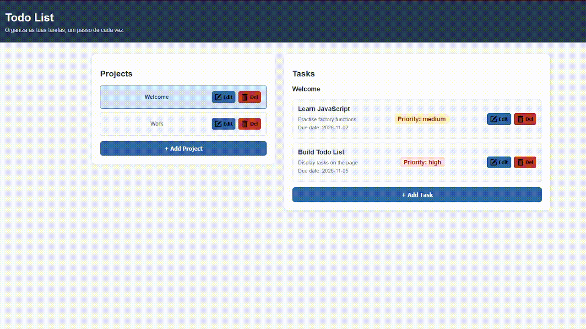

# Project: Todo List | The Odin Project
 
O objetivo deste projeto foi desenvolver uma aplicação Todo List utilizando JavaScript, HTML e CSS, com o apoio do Webpack.

A aplicação permite ao utilizador criar e gerir diferentes projetos, adicionar tarefas a cada projeto, editar as suas informações e eliminar projetos ou tarefas. Cada tarefa inclui um título, uma descrição, uma data limite e um nível de prioridade, podendo também ser marcada como concluída.

Este projeto faz parte do percurso JavaScript do The Odin Project e teve como principal objetivo consolidar os conhecimentos adquiridos em JavaScript, especialmente na organização do código em módulos e na criação de aplicações interativas.

Durante o desenvolvimento, foram aplicados conceitos como manipulação do DOM, módulos JavaScript, importação e exportação de funções, event listeners, gestão de estado, métodos de arrays, localStorage, separação entre lógica da aplicação e manipulação da interface, e utilização do Webpack para gerir dependências e preparar a aplicação para produção.

## Podes visualizar o projeto aqui:
https://rafaelribeiro2003.github.io/Project-Todo-List-theodinproject/

## Screenshot:

## Créditos: 
Este projeto foi desenvolvido como parte do currículo do **The Odin Project**.

---
## 🇬🇧 English

The goal of this project was to develop a Todo List application using JavaScript, HTML, and CSS, with the help of Webpack.

The application allows users to create and manage different projects, add tasks to each project, edit their information, and delete projects or tasks. Each task includes a title, description, due date, and priority level, and can also be marked as completed.

This project is part of The Odin Project's JavaScript curriculum and its main objective was to consolidate the JavaScript knowledge acquired throughout the course, particularly in code organization through modules and the development of interactive applications.

During development, concepts such as DOM manipulation, JavaScript modules, importing and exporting functions, event listeners, state management, array methods, localStorage, separation of application logic from DOM manipulation, and the use of Webpack to manage dependencies and prepare the application for production were applied.

## Live Demo
https://rafaelribeiro2003.github.io/Project-Todo-List-theodinproject/

## Screenshot

## Credits
This project was completed as part of **The Odin Project** curriculum.
